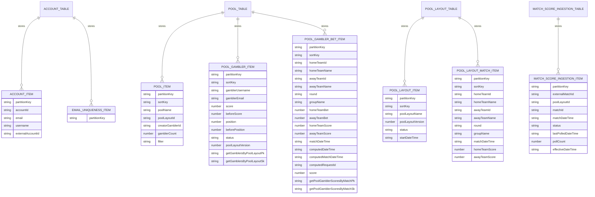

# Tyche DynamoDB Model

The persistence layer uses **four DynamoDB tables**, one per bounded context:
`Account`, `Pool`, `PoolLayout`, `MatchScoreIngestion`. Each table follows the **single-table design** pattern internally — multiple entity types share the same `pk`/`sk` keys, distinguished by prefixed key values (e.g. `POOL#<ulid>`, `GAMBLER#<ulid>`, `MATCH#<ulid>`). Tables are split by domain (not collapsed into one) so each bounded context owns its schema, lambdas, and DynamoDB Streams independently.

Schema definitions live in `*Table.fs` files (e.g. `Felipearpa.Tyche.Pool/src/Infrastructure/PoolTable.fs`) and key strings are built via `KeyPrefix.build` from `Felipearpa.Data.DynamoDb`.

## Entity / Key Map

The diagram shows `partitionKey`/`sortKey` for readability — the real DynamoDB column names are `pk` and `sk`.



## Key Patterns by Entity

| Entity | Table | `pk` | `sk` |
|---|---|---|---|
| Account | `Account` | `ACCOUNT#<accountId>` | — |
| Email lock | `Account` | `EMAIL#<email>` | — |
| Pool root | `Pool` | `POOL#<poolId>` | `POOL#<poolId>` |
| Pool gambler / score | `Pool` | `POOL#<poolId>` | `GAMBLER#<gamblerId>` |
| Pool gambler bet | `Pool` | `GAMBLER#<gamblerId>#POOL#<poolId>` | `MATCH#<matchId>` |
| Settlement receipt | `Pool` | `POOL#<poolId>` | `SETTLEMENT#<operationId>` |
| Pool layout root | `PoolLayout` | `POOLLAYOUT#<layoutId>` | `POOLLAYOUT#<layoutId>` |
| Pool layout match | `PoolLayout` | `POOLLAYOUT#<layoutId>` | `MATCH#<matchId>` |
| Match score ingestion | `MatchScoreIngestion` | `MATCH#<matchId>` | — |

## Real Item Examples

`Account` table — account record + email uniqueness lock:

```
{ "pk": "ACCOUNT#01KQBTS379WKPAQFJEM2HAA0J6", "accountId": "01KQBTS3…", "email": "user@example.com", "username": "felipe", "externalAccountId": "<firebase-uid>" }
{ "pk": "EMAIL#user@example.com" }
```

`Pool` table — three entity shapes coexist:

```
# Pool root
{ "pk": "POOL#01KQ7PXAR21QBJBEEQ7EFRNQGE", "sk": "POOL#01KQ7PXAR21QBJBEEQ7EFRNQGE", "poolName": "...", "poolLayoutId": "...", "creatorGamblerId": "...", "gamblerCount": 8 }

# Pool membership / score row
{ "pk": "POOL#01KQ7PXAR21QBJBEEQ7EFRNQGE", "sk": "GAMBLER#01KQ7PWR1HGFE4TXT5MPSZW595", "gamblerUsername": "felipe", "score": 12, "position": 3, "status": "OPENED" }

# Bet on a match
{ "pk": "GAMBLER#01KQFJP456DCP6F1S83H44W08A#POOL#01KQ7RB178WS8FEZX3ZXWT5TR0",
  "sk": "MATCH#01KQ7QY1PWNYGFFD5VSWAR8H9V",
  "homeTeamBet": 2, "awayTeamBet": 1, "matchDateTime": "2026-06-12T17:00:00Z" }
```

`PoolLayout` table — layout root + its matches:

```
{ "pk": "POOLLAYOUT#01KQ3GSQ96C6BMKF1FGXP2767H", "sk": "POOLLAYOUT#01KQ3GSQ96C6BMKF1FGXP2767H", "poolLayoutName": "World Cup 2026", "status": "OPENED" }
{ "pk": "POOLLAYOUT#01KQ3GSQ96C6BMKF1FGXP2767H", "sk": "MATCH#01KQ3HPW41N7XVP1B1QACTGRHG", "homeTeamName": "...", "matchDateTime": "..." }
```

`MatchScoreIngestion` table — one control item per match being auto-ingested (pk-only, no `sk`):

```
{ "pk": "MATCH#01KQ3HPW41N7XVP1B1QACTGRHG", "externalMatchId": "497559", "poolLayoutId": "01KQ3GSQ…",
  "matchId": "01KQ3HPW…", "matchDateTime": "2026-06-12T17:00:00Z", "status": "PENDING",
  "lastPolledDateTime": "2026-06-12T18:52:00Z", "pollCount": 3 }
```

## Global Secondary Indexes

| Table | Index | Hash | Range | Purpose |
|---|---|---|---|---|
| Account | `GetByEmail-index` | `email` | — | Look up account by email at sign-in |
| Pool | `GetPendingPoolGamblerBets-index` | `pk` (`GAMBLER#…#POOL#…`) | `matchDateTime` | Bets a gambler still has to make, oldest match first |
| Pool | `GetFinishedPoolGamblerBets-index` | `pk` (`GAMBLER#…#POOL#…`) | `computedDateTime` | Bets already scored, by computation time. No code reads it since History and Timeline became grouped; kept for operator queries |
| Pool | `GetFinishedPoolGamblerBetsByMatchDate-index` | `pk` (`GAMBLER#…#POOL#…`) | `computedMatchDateTime` | Bets already scored by kickoff, so a kickoff group's rows are adjacent (grouped History and Timeline); ALL projection, owned by `operations/pool-table.sh` |
| Pool | `GetPoolGamblerScoresByGambler-index` | `sk` (`GAMBLER#…`) | `score` | All pools a gambler is in, ranked |
| Pool | `GetPoolGamblerScoresByPool-index` | `pk` (`POOL#…`) | `score` | Leaderboard within a pool |
| Pool | `GetPoolGamblerScoresByMatch-index` | `getPoolGamblerScoresByMatchPk` (`MATCH#…`) | `getPoolGamblerScoresByMatchSk` (`POOL#…#GAMBLER#…`) | Fan-out: every bet on a match across all pools when score is published |
| Pool | `GetGamblersByPoolLayout-index` | `getGamblersByPoolLayoutPk` (`POOLLAYOUT#…`) | `getGamblersByPoolLayoutSk` | Backfill new matches into every gambler's bet sheet when a layout adds matches |
| Pool | `GetPoolGamblersByUsername-index` | `pk` (`POOL#…`) | `gamblerUsername` | Pool members listed alphabetically by username (member management) |
| Pool | `GetPoolMatchBetsByTotal-index` | `getPoolMatchBetsByTotalPk` (`POOL#…#MATCH#…`) | `getPoolMatchBetsByTotalSk` (ranking key) | Ranked match bets: complete participant rows ordered by pool total (INCLUDE projection, 20 attributes) |
| PoolLayout | `GetOpenedPoolLayout-index` | `status` | `startDateTime` | List currently open layouts users can join |

## How the Model Is Built

- **Denormalized display data on membership and bet items.** `gamblerUsername` is copied onto pool gambler items (and kept in sync via `UpdateGamblerScoreUsernameRequestBuilder` / `UpdateGamblerBetUsernameRequestBuilder` when it changes), and team names / `round` / `groupName` are copied from layout matches onto bet items during fan-out — so list queries never need cross-table joins.
- **`MatchScoreIngestion` is a stream-driven control table.** One pk-only item per match to auto-ingest; its DynamoDB Stream (`NEW_AND_OLD_IMAGES`) creates a per-match self-terminating EventBridge schedule that polls football-data.org and writes the score, which the existing `GetPoolGamblerScoresByMatch-index` fan-out then propagates. `status` moves `PENDING → COMPLETED` (or `EXPIRED`).
- **Composite keys encode the access pattern.** `POOL#…` + `GAMBLER#…` lets one query return a pool and all its members; `GAMBLER#…#POOL#…` + `MATCH#…` localizes a gambler's bets to one partition for fast list queries.
- **Denormalized GSI keys.** `getPoolGamblerScoresByMatchPk/Sk` and `getGamblersByPoolLayoutPk/Sk` are extra attributes written alongside the item so a single record can be queried from multiple angles without scans. They are written by `*RequestBuilder.fs` / `*Transformer.fs` modules.
- **Sentinel attributes act as filters.** Whether a bet is *pending* vs *finished* is decided by whether `computedRequestId` exists — pending queries use `attribute_not_exists(computedRequestId)`, finished queries hit the GSI keyed on `computedMatchDateTime` to read finished bets by kickoff (the older GSI keyed on `computedDateTime` remains on the table). Both sort keys are written only when a detail is computed, so pending details never enter either finished index.
- **Uniqueness via lock items.** A second `EMAIL#…` row in `Account` enforces email uniqueness through a conditional `Put` (`attribute_not_exists(pk)`), since DynamoDB has no unique-secondary-index concept.
- **Scoring is an ordered pool operation.** A result is dispatched as one versioned command per pool on the `UpdatePositionsQueue.fifo` queue (message group = pool) before anything is scored; the consumer settles every membership's detail and then finalizes positions as one resumable operation. A rejoin's restoration of retained history runs through the same queue. See [Settlement, positions, and ranking](pool-settlement.md).

## Settlement, identity, and projection records

These attributes were added by the `redesign-match-bets` change, the rejoin restoration attributes by `restore-rejoin-history`, and the kickoff-group attributes (`trendKickoffDateTime`, `computedMatchDateTime`, the checkpoint's trend decision) by `group-kickoff-rank-movement`. All are additive; existing attributes keep their meaning.

### Pool root (`POOL#<poolId>` / `POOL#<poolId>`)

| Attribute | Type | Meaning |
|---|---|---|
| `membershipRevision` | N | Advanced in the same transaction as every join and removal (`gamblerCount` update). Position calculations capture it and restart if it changes. Absent means 0. |
| `operationRevision` | N | Revision assigned to the last admitted operation. Absent means 0. |
| `activeOperation` | M | The fixed-size checkpoint of the one active operation: `operationId`, `revision`, target (`MATCH` with `matchId`, `homeTeamScore`, `awayTeamScore`, `resultVersion`, and the trend decision taken at admission: `trendEffect` `OPENS` with `trendKickoff`, or `KEEPS`; a match checkpoint without `trendEffect` was admitted before kickoffs were compared and records the baseline without changing the trend kickoff; `STANDINGS`; or `RESTORE` with `gamblerId` and `generation`), `stage` (`SCORING`/`POSITIONS`; a restoration rebinds details in `SCORING`), `cursor` (the last gambler ID settled, or for a restoration the last match ID of the gambler's details handled), `calculationRevision`, `membershipRevision`, `ownerToken`, `leaseExpiresAt`, `attemptsWithoutProgress`, `blocked`, `unresolvedDetails`, `restoredDetails` (details a restoration rebound so far; its positions stage runs only when this is above zero; 0 for other targets, and absent on checkpoints written before restorations existed), `admittedAt`, `lastProgressAt`. Absent when no operation is active. |
| `lastCompletedOperationRevision` | N | Revision of the last completed operation. |
| `rankingReadiness` | M | `state` (`READY`/`NOT_READY`), `schemaVersion`, `checkedMembers`, `checkedDetails`, `unresolved`, `checkedAt`. Ranked reads require `READY`. |
| `trendKickoffDateTime` | S | ISO-8601 UTC kickoff of the trend group: the group whose baseline the memberships' `beforePosition` holds. A match settlement whose kickoff is newer than this value (or that finds it absent) records each membership's previous position on its first write, and its completion sets this value in the same transaction that clears the checkpoint, fenced by the owner token. A settlement of the same or an older kickoff keeps both. It only moves forward. Absent until the first match settlement completes; score responses expose it as `trendGroup`. The kickoff-group backfill sets it on a root that has none, conditioned on no active operation and the `operationRevision` it read. |

### Settlement receipt (`POOL#<poolId>` / `SETTLEMENT#<operationId>`)

One small item per logical operation, kept for the pool's lifetime and deleted with the pool. It carries no `score`, `gamblerUsername`, `matchDateTime`, or `computedDateTime`, so it never appears in the leaderboard, member, pending, or finished indexes, and membership queries stay restricted to `begins_with(sk, "GAMBLER#")`.

| Attribute | Meaning |
|---|---|
| `operationId` | Stable logical identity (see [Operation IDs](#operation-ids)). |
| `operationRevision` | Revision assigned at admission. |
| `operationFingerprint` | Identifies the immutable payload; reusing the ID with another payload is an error. |
| `operationState` | `ADMITTED`, `COMPLETED`, or `DEFERRED` (held while the pool is blocked). |
| `operationCommand` | The versioned command JSON, so deferred commands can be enqueued again. |
| `admittedDateTime`, `completedDateTime`, `deferredDateTime`, `unresolvedDetails` | Audit and repair data. For a restoration, `unresolvedDetails` counts the retained details held for repair. |

#### Operation IDs

| Operation ID | Command | Requested by |
|---|---|---|
| `RESULT#<matchId>#<resultVersion>` | `SETTLE_RESULT` | Result dispatch |
| `MATCH#<matchId>#<source>` | `RECONCILE_MATCH` | Added-match fan-out, join materialization, reconciliation, legacy messages |
| `STANDINGS#<source>` | `RECONCILE_STANDINGS` | Membership joins and removals |
| `RESTORE#<gamblerId>#<membershipGeneration>` | `RESTORE_REJOIN_HISTORY` | Every membership insert (stream), and reconciliation for a membership with retained details neither restored nor held |
| `RESTORE#<gamblerId>#<membershipGeneration>#<source>` | `RESTORE_REJOIN_HISTORY` | An operator replay after repair (`operations/restore-rejoin-history.sh`); same payload under a new identity |

The restore command carries `gamblerId` and `membershipGeneration`; its payload fingerprint is `RESTORE_REJOIN_HISTORY|<poolId>|<gamblerId>|<membershipGeneration>`, independent of the operation ID.

### Membership (`POOL#<poolId>` / `GAMBLER#<gamblerId>`)

| Attribute | Meaning |
|---|---|
| `membershipGeneration` | Unique per membership lifetime (a ULID written at join). A rejoin gets a new one. |
| `scoreVersion` | Starts at 1 and advances in the same transaction as every change of `score`. |
| `positionOperationRevision`, `positionCalculationRevision` | The operation and calculation that last wrote `position`; `beforePosition` is recorded only on the first write of a match settlement that opens a newer kickoff group (see the root's `trendKickoffDateTime`), so it holds the position before that group. Later settlements of the same group, late results and corrections of older groups, and standings reconciliations leave it unchanged. |

`score` stays the authoritative pool total and `beforeScore` keeps its meaning (the total before the latest settled match).

### Match detail (`GAMBLER#<gamblerId>#POOL#<poolId>` / `MATCH#<matchId>`)

| Attribute | Meaning |
|---|---|
| `poolMembershipGeneration` | The membership lifetime the detail belongs to. Settlement, positions, and projection writes require it to equal the membership's generation. Only a rejoin restoration moves a computed detail to a later generation. |
| `resultVersion` | Result version the detail reflects. A computed detail without it reflects version 1 (scored before versioning). |
| `settlementOperationId`, `settlementOperationRevision` | The operation that last applied a result, or the restoration that rebound the detail. |
| `positionOperationRevision`, `positionCalculationRevision` | As on the membership; the membership and detail positions are written in one transaction. |
| `totalPoolPoints`, `totalPoolPointsState` | Copy of the membership total (`KNOWN`), or `UNAVAILABLE` without a number. Never the match award. |
| `poolScoreVersion` | The membership `scoreVersion` the copy reflects; copies only move forward. |
| `rankingActive` | `true` while the detail belongs to a current membership; `false` is a retained tombstone after removal. |
| `getPoolMatchBetsByTotalPk`, `getPoolMatchBetsByTotalSk` | Ranking index keys; removed when the projection is retired. |
| `restoreExcludedGeneration` | The membership generation whose restoration held this retained detail for repair (malformed, or its match is missing or has no result). Restoration and reconciliation treat the detail as resolved for that generation only; a later rejoin's generation is not blocked by it. Removed when the detail is rebound. |
| `restoreExclusionReason` | Why the detail was held, for example `computed detail without an award` or `match missing`. |
| `computedMatchDateTime` | Copy of the detail's `matchDateTime` (same ISO-8601 UTC format), written with `if_not_exists` by the settlement write that first computes the detail, or with the late-join computed detail. Corrections keep it. Pending details never have it, so it gates `GetFinishedPoolGamblerBetsByMatchDate-index`. Details computed before it existed lack it until the kickoff-group backfill. |

`score` on the detail stays this match's award; `computedRequestId` and `computedDateTime` keep their meaning, and `computedDateTime` is preserved by corrections. The detail's `position` and `beforePosition` are its own snapshot, written on the first write of every match settlement or correction whatever its kickoff group.

### Rejoin restoration writes

`PoolProjectionRequestBuilder.rebind` moves one retained computed detail to the rejoined membership in one transaction:

| Item | Writes | Condition |
|---|---|---|
| Detail | `poolMembershipGeneration` = new generation, `rankingActive = true`, both ranking keys, `totalPoolPoints` / `totalPoolPointsState = KNOWN` / `poolScoreVersion` = the membership's total and score version after this transaction, `resultVersion`, `settlementOperationId` / `settlementOperationRevision` = the restore operation; with a re-evaluated award also `homeTeamScore`, `awayTeamScore`, `score`. Removes `restoreExcludedGeneration`, `restoreExclusionReason`. Predictions, `computedDateTime`, and positions are not touched. | `attribute_exists(pk)`, `attribute_exists(computedRequestId)`, `poolMembershipGeneration` = the generation read (or `attribute_not_exists` when read without one), `score` = the award read, `resultVersion` = the version read (or `attribute_not_exists`) |
| Membership | `score` = previous total + award and `scoreVersion` + 1 when the award is not zero; otherwise a condition check only. `beforeScore` is not changed. | `membershipGeneration` = new generation, `scoreVersion` = expected, `score` = previous total |

`PoolProjectionRequestBuilder.holdForRestore` sets `restoreExcludedGeneration` = new generation and `restoreExclusionReason` on a detail, conditioned on `attribute_exists(pk)` and the generation read (or its absence).

### Ranking key

`getPoolMatchBetsByTotalSk` sorts ascending as known totals descending, then gambler ID ascending, then unavailable totals by gambler ID:

```
1#K#<2147483647 − total, 10 digits>#<gamblerId>     known total (any Int32, including 0 and negatives)
1#U#<gamblerId>                                     unavailable total
```

The leading `1` is the key schema version that ranked cursors carry.

### PoolLayout match

`resultVersion` (N) is 1 for the first published result (`SetMatchFinalScoreRequestBuilder` writes it with the score) and increases with each supported correction (`CorrectMatchResultRequestBuilder`). A result written before versioning has no attribute and counts as version 1.

### Access patterns added

| Access | Read |
|---|---|
| Discover pools with a match (dispatch) | `GetPoolGamblerScoresByMatch-index`, every page, including computed details. Eventually consistent: discovery only, never a completion barrier. |
| Authoritative memberships (settlement, positions, migration) | Base table `pk = POOL#<poolId>`, `begins_with(sk, GAMBLER#)`, `ConsistentRead`. |
| Existing details of a match (settlement, positions) | `BatchGetItem` with `ConsistentRead`, unprocessed keys retried. |
| A member's details (propagation, removal, backfill, rejoin restoration) | Base table `pk = GAMBLER#<gamblerId>#POOL#<poolId>`, `ConsistentRead`. |
| Ranked participant page | `GetPoolMatchBetsByTotal-index` only, no enrichment. |
| Grouped History, Timeline's settled phase | `GetFinishedPoolGamblerBetsByMatchDate-index`, newest kickoff first, plus one `computedMatchDateTime = <kickoff>` query to complete the page's last group; the layout partition for counts. |
| Timeline's unsettled phase | `GetPendingPoolGamblerBets-index` (`matchDateTime` up to the lock horizon, uncomputed only), plus one `matchDateTime = <kickoff>` query per group for all of its details. |
| Kickoff copies (rescheduled match, backfill) | `GetPoolGamblerScoresByMatch-index` for the match (narrowed with `begins_with(getPoolGamblerScoresByMatchSk, POOL#<poolId>#)` by the backfill), then one `UpdateItem` per detail conditioned on the `matchDateTime` and `computedMatchDateTime` it was planned from; a failed condition re-reads the detail strongly. |
