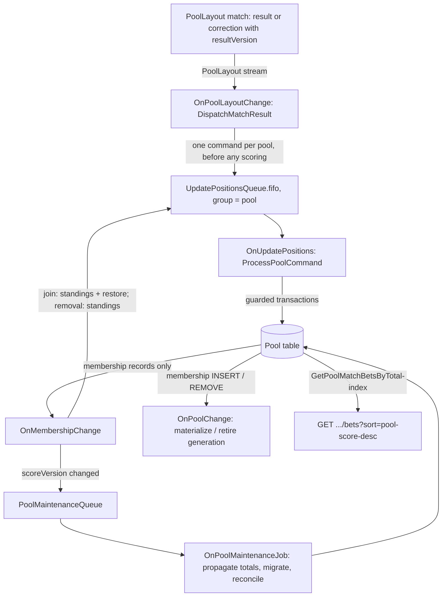

# Settlement, positions, and ranked match bets

How a match result becomes pool totals, positions, and the ranked match-bets feed. The records are described in [database-model.md](database-model.md); operator procedures are in [Amazon.Lambda/operations/README.md](../Amazon.Lambda/operations/README.md).

## Flow

Responsibilities follow the project's layering: the domain holds the pure rules (`BetEvaluator`, `SettlementPolicy`, `RestorePolicy`, `PositionPolicy`, `RankingKey`); repositories (`PoolSettlementDynamoDbRepository`, `RankedMatchBetsDynamoDbRepository`, `PoolGamblerBetDynamoDbRepository`) only read and perform single guarded writes; application services (`DispatchMatchResult`, `ProcessPoolCommand` with its `SettlementPass`, `RestorePass`, and `PositionsPass`, `FanOutMatchToGamblers`, `MaterializeJoinedGambler`, `ReactToMembershipChanges`, `PropagateMembershipTotal`, `CleanUpRemovedMembership`, migration and reconciliation services, `GetRankedPoolMatchBets`) orchestrate; Lambda event handlers own messaging, deadlines, and metrics.

## Commands

Commands are versioned JSON on the FIFO queue (`PoolMessageJson`), message group = pool, deduplication ID = `<poolId>#<operationId>` (SQS deduplication is queue-wide and only an optimization; receipts are the idempotency contract).

| Kind | Operation ID | Sent by | Does |
|---|---|---|---|
| `SETTLE_RESULT` | `RESULT#<matchId>#<resultVersion>` | result dispatch | Settle that result version, then positions paired with the match details |
| `RECONCILE_MATCH` | `MATCH#<matchId>#<source>` | added-match fan-out when the match already has a result (source = the insert's stream event); join materialization that raced a result; reconciliation; translated legacy messages (`LEGACY#<messageId>`) | Settle the match's current result (read at admission), then positions; no work if the match has no result |
| `RECONCILE_STANDINGS` | `STANDINGS#<source>` | membership joins and removals | Recalculate current membership positions only; no match detail is required or written |
| `RESTORE_REJOIN_HISTORY` | `RESTORE#<gamblerId>#<membershipGeneration>` (operator replays add `#<source>`) | every membership insert; reconciliation for a membership with retained details that are neither restored nor held; operator replay | Rebind the gambler's retained computed details to the membership, then recalculate current positions ([Rejoin restoration](#rejoin-restoration)) |

Messages written by the previous position worker (`poolId|matchId`) are still accepted and run as `RECONCILE_MATCH`.

## One operation per pool

`ProcessPoolCommand` handles each delivery:

1. **Assist first.** If the pool root has another active operation, the delivery claims and finishes it before admitting its own. A later command therefore never overtakes an earlier one, even when the earlier one's message reached the dead-letter queue (the fence stays on the root).
2. **Admission.** A receipt (`SETTLEMENT#<operationId>`) and the root checkpoint are written in one transaction, conditioned on no active operation and the observed `operationRevision`. A completed receipt makes any redelivery or older replay a no-op (`AlreadyCompleted`); a receipt with another payload fingerprint is an error.
3. **Scoring stage.** Strongly consistent membership pages (100) and strongly consistent `BatchGetItem` of their details. Each detail is decided by `SettlementPolicy` and written in one transaction with its membership: detail award/result/`resultVersion` guarded by generation and expected prior version; membership total guarded by generation, `scoreVersion`, and the previous total, which advances `scoreVersion` only when the total changes. A zero award still finalizes the detail. Missing details stay pending (counted in `unresolvedDetails`); they are never upserted or settled as no bet. Conditional failures are re-read and classified (already applied, removed or replaced membership, changed version → retry); contention retries with backoff; throttling and other errors propagate. The cursor is checkpointed after every page. If the membership revision changed during the pass, the pass runs again.
4. **Positions stage.** All memberships are read strongly, ranked by total descending and gambler ID ascending, and written with per-operation markers: the membership and the target match detail in one transaction. The first write of a match settlement or correction records `beforePosition`, so the leaderboard trend compares with the last scored match; recalculations keep it; a standings reconciliation after a join or removal moves `position` and leaves `beforePosition` unchanged; an older operation never overwrites a newer marker. A membership change during the pass, or a membership whose version moved, starts a new calculation revision. Unrelated historical match positions are never rewritten.
5. **Completion.** The receipt becomes `COMPLETED` and the checkpoint is removed in one transaction fenced by the owner token. Deferred commands (below) are then enqueued again.

Ownership: every claim writes a new owner token and lease. Checkpoint saves and completion require the token, so an expired worker cannot move the cursor or complete. Admission, checkpoint saves, and completion retry transaction contention on the root with the same jittered backoff as row writes; only a condition that no longer holds means another worker owns the operation. Row writes do not check the root (concurrent transactions that check one item contend; measured: 39 of 90 conflicted at concurrency 30), so they are fenced by row state instead: generation, expected `resultVersion` and `scoreVersion`, and position operation markers. A stale worker's row write either fails those conditions or applies exactly the same change the current owner would.

Deadline: the handler stops starting work 45 s before its timeout, saves the checkpoint with an expired lease, and makes the message visible again at once (`ChangeMessageVisibility 0`). A delivery that finds the lease still held by another worker also yields, but asks the handler to keep the message invisible for the rest of that lease (`RetryAfter` on the command report), so it waits instead of spinning through receive counts. The original message stays unacknowledged until both stages complete; no continuation is appended behind later commands.

Blocked pools: each claim without progress increments `attemptsWithoutProgress`; past 5 the checkpoint is marked `blocked` and the `OperationBlocked` metric alarms. Commands that arrive for a blocked pool are stored as `DEFERRED` receipts and acknowledged, so they do not cascade into the dead-letter queue; they are re-enqueued in deferral order when the blocked operation completes after repair.

## Budgets

| Setting | Value | Reason |
|---|---|---|
| `OnUpdatePositions` timeout | 300 s | Room for several membership pages per invocation |
| Lease (`PoolOperationSettings.LeaseDuration`) | 5 min | At least the timeout |
| Deadline margin | 45 s | Checkpoint and response |
| FIFO visibility timeout | 1800 s | Six timeouts; deadline yields bypass it, and a yield to a live lease waits only for the rest of that lease (at most 5 min) |
| FIFO `maxReceiveCount` | 30 | Deliberate yields consume receive counts; a yield to a live lease costs one receive per lease, and at 5 failed claims the pool is blocked long before redrive |
| Membership page / write concurrency | 100 / 16 | Checkpoint interval and transactions per pool |
| Maintenance queue | visibility 720 s (6 × 120 s), `maxReceiveCount` 5, event source `MaximumConcurrency` 16 (template parameter `PoolMaintenanceMaximumConcurrency`) | Rate limit for propagation and backfill; 16 workers propagated one result across a 5,000-member pool in about 210 s |
| Stream mappings | 10 retries, 6 h record age, batch bisection, partial batch responses, S3 failure destination | Poison records are isolated and retained with full payloads |

The load measurements against these budgets are in the change's `verification.md`. Every function, including the HTTP API, shares the account's Lambda concurrency limit of 1,000. Propagation takes at most 16 of those, and the settlement FIFO consumer is uncapped: it runs at most one invocation per pool message group in flight. A 1,000-invocation burst of ranked reads ran without throttles, so a 1,000-viewer burst fits alongside settlement and propagation, while bursts of new instances pay a cold start of about 1.1 s (init plus first request).

## Pool-total projection

Every active match detail carries a copy of its membership's total (`totalPoolPoints`, `poolScoreVersion`) and the ranking keys. When a membership's `scoreVersion` changes, `OnMembershipChange` enqueues `PROPAGATE_TOTAL`; the job reads the latest membership and copies the absolute total to each active detail of the same generation whose `poolScoreVersion` is older. Duplicates, older jobs, and reordering converge; a later decrease still applies. Position, before-score, and username writes do not change `scoreVersion`, so they never trigger propagation, and detail writes never reach the handler (event source filter on `GAMBLER#` memberships).

Details are only created by the materializers (join, added match, reconciliation), always through a transaction that checks the membership still has the read generation and `scoreVersion`, so a total that changes before the row exists cannot leave it stale. Removal retires the removed generation (captured from the stream's old image): uncomputed details of that generation are deleted, computed ones lose their ranking keys and keep a tombstone; details of any other generation, such as a rejoined membership's, are untouched. When the gambler rejoins, the restore operation moves those tombstones to the new generation with a full projection, and propagation then copies the final total to them like to any other detail ([Rejoin restoration](#rejoin-restoration)).

Copies are eventually consistent: during propagation a match can hold copies from different score versions, and the index adds its own delay.

## Rejoin restoration

A gambler removed from a pool keeps their computed details as tombstones of the removed generation. When they rejoin, the new membership continues with that history:

1. **Request.** `OnMembershipChange` enqueues `RESTORE_REJOIN_HISTORY` for every membership insert, after the join's standings reconciliation and before the stream record is acknowledged; an enqueue failure fails the batch and the stream retries it. The identity `RESTORE#<gamblerId>#<membershipGeneration>` makes duplicate deliveries no-ops through the receipt. A join without retained details completes the restoration without changes to any total or position. `RECONCILE_POOL` requests the same command for a membership that has computed details bound to an earlier generation that are neither restored nor held for repair.
2. **Ordered operation.** The command is admitted like any other pool command (receipt, active fence, checkpoints, deadline yields, blocked-pool handling), so settlement, corrections, and positions never interleave with it. The rebinding runs in the `SCORING` stage: a strongly consistent page (100) of the gambler's detail partition, then one guarded transaction per retained detail, in order, because each one checks the same membership total. The cursor (last match ID) and the count of rebound details are checkpointed after every page.
3. **One detail.** A retained detail is a computed detail with another generation or none. Its match's authoritative result is read from the layout (`RestorePolicy`): if the detail reflects an older result version, its award is re-evaluated with the current formula; otherwise it keeps its award. The transaction moves the detail to the new generation with both ranking keys, the membership's post-transaction total and `scoreVersion` as its copy, and the operation as `settlementOperationId`, and adds the award to the membership total with a `scoreVersion` advance. It is guarded by the detail's read generation (or its absence), award, and result version, and by the membership's generation, `scoreVersion`, and previous total. Predictions, `computedDateTime`, historical positions, and `beforeScore` are not changed. The full projection is written because a tombstone has no ranking keys, and its copied version can be higher than the new membership's (which restarts at 1) or missing on legacy details; propagation alone would skip it.
4. **Failed conditions** are classified from a fresh read, as in settlement: a detail that already has the new generation was applied by an attempt whose response was lost and is counted once; a changed `scoreVersion` or detail is decided again; a removed or replaced membership stops the pass, which then completes. The remaining details stay retained for a later rejoin, since each rebinding is conditioned on the read generation and happens at most once.
5. **Held for repair.** A computed detail without an award, a detail whose match is missing or has no result, or one that reflects a newer result version than its match is not rebound and not counted. It gets `restoreExcludedGeneration = <new generation>` and `restoreExclusionReason`, conditioned on its read generation, and is counted in the receipt's `unresolvedDetails`. Restoration and reconciliation treat it as resolved for that generation; a later rejoin's generation is not blocked by the old marker. Repair: [operations/README.md](../Amazon.Lambda/operations/README.md#held-rejoin-detail).
6. **Standings.** After every retained detail has an outcome, and only if the operation rebound at least one detail (the checkpoint's `restoredDetails`, which survives deadline yields), the `POSITIONS` stage recalculates current positions with the standings-reconciliation rule: `position` moves, `beforePosition` stays unchanged for every membership, and no match detail position is written. A restoration that rebound nothing completes without a position pass; the join's own standings reconciliation already placed the membership.
7. **Propagation.** Each `scoreVersion` advance requests `PROPAGATE_TOTAL`, which copies the final total to every active detail of the generation, including restored ones that hold an earlier copy from the same pass. Rows appear in older matches' ranked lists once propagation and the index converge. A later correction of a restored match applies its award difference through the normal correction path.

Matches without a retained detail follow the existing join rules: details deleted at removal are not recreated, open matches can be predicted again, and matches scored during the absence get the late-join detail with zero points.

## Ranked match bets endpoint

`GET /pools/{poolId}/matches/{matchId}/bets?sort=pool-score-desc&next=<cursor>`

Without `sort` the endpoint keeps its previous behavior and cursor. An unknown `sort` is `400`.

Every ranked request, independently of any cursor or projection row:

1. Resolves the caller from the JWT and requires a current membership (strong read). Removed requesters are denied while their cleanup is still running.
2. Reads the layout match strongly: predictions are revealed when the match has a result or `now ≥ kickoff − 10 min` (the existing lock policy). Otherwise `409 PREDICTIONS_HIDDEN`.
3. Requires the pool's `rankingReadiness = READY` (recorded by `VERIFY_READINESS`, cleared by `operations/mark-pool-not-ready.sh`). Otherwise `503 RANKING_NOT_READY`.
4. Queries `GetPoolMatchBetsByTotal-index` for up to 50 rows (at most three index queries to fill a page) and returns them as they are: no per-row or per-page enrichment.

| Status | `error` | Meaning |
|---|---|---|
| 200 | — | `{ items, next }`; items have the existing match-bet shape, `score` is this match's award |
| 400 | `INVALID_CURSOR`, `CURSOR_CONTEXT_MISMATCH` | Restart from the first page |
| 401 / 403 | — / `NOT_POOL_MEMBER` | Not authenticated / not a current member |
| 404 | `POOL_NOT_FOUND`, `MATCH_NOT_FOUND` | |
| 409 | `PREDICTIONS_HIDDEN` | Betting is still open |
| 503 | `RANKING_NOT_READY`, `RANKING_UNAVAILABLE` | The pool is not verified ready, or the index cannot be read; retry later. Never answered with another order. |

The cursor is base64url JSON holding the cursor version, mode, ranking key schema, pool, match, and the native start key. The partition key of the start key is rebuilt from the request path, and a cursor from another pool, match, mode, or schema is rejected. For unchanged projections, paging returns every participant once in order, ties included. When totals change while a viewer pages, rows can move across page boundaries; clients deduplicate by gambler ID and refresh by discarding cursors and loading the first page again. There is no frozen snapshot.

## Migration and readiness

Run per pool, through the maintenance queue (operations/README.md):

1. `INITIALIZE_IDENTITIES` gives memberships a generation and `scoreVersion = 1` and binds their details; computed details get `resultVersion = 1`. A membership whose computed awards do not add up to its total is held unbound for repair (it may hold retained details of an earlier membership).
2. `BACKFILL_PROJECTION` activates the projection on every bound detail through the guarded initializer. Restarting is safe.
3. `VERIFY_READINESS` checks every membership's details for an active projection with the current total and version, and no unbound or stale-generation active rows; it records `READY` only if the membership revision did not change during the check.
4. `RECONCILE_POOL` repairs what lost or expired work left: missing details, details whose match result is not reflected, lagging copies, uninitialized projections, active rows of another generation, and memberships behind the last completed operation.
