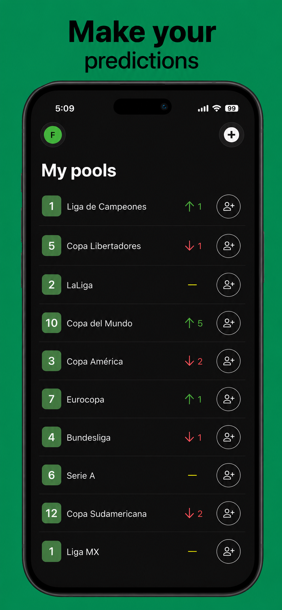
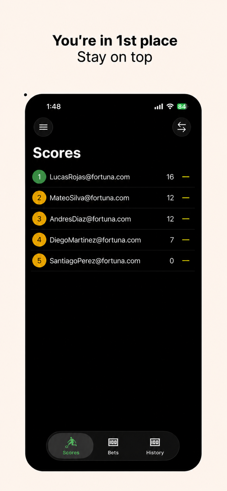
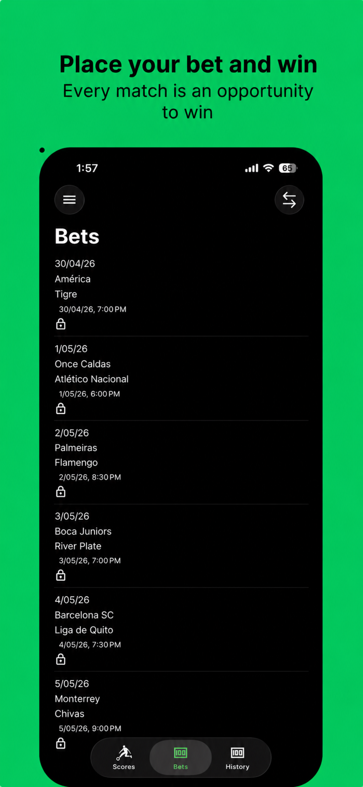
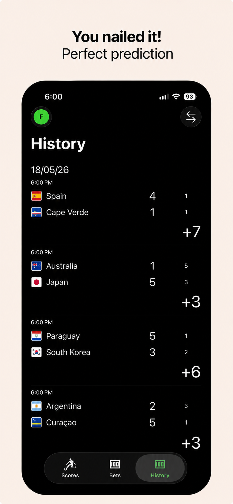

# Fortuna for iOS

### Predict. Compete. Win the bragging rights.

The iOS client for **Fortuna** — the prediction pool app that turns every match into a competition between friends. Built native with Swift and SwiftUI.

> *Developed under the codename **Tyche**. The consumer-facing app is **Fortuna**.*

---

## Get Fortuna on iOS

<table>
  <tr>
    <td align="center" valign="middle" width="50%">
      <a href="https://apps.apple.com/app/fortuna/id6762291676">
        
      </a>
    </td>
    <td align="center" valign="middle" width="50%">
      <a href="https://apps.apple.com/app/fortuna/id6762291676">
        
      </a>
    </td>
  </tr>
</table>

Available on **iPhone and iPad**.

## Screenshots

<p align="center">
  
  
  
  
</p>

## Tech stack

- **Language** — Swift
- **UI** — SwiftUI
- **Auth** — Firebase Authentication (email link sign-in)
- **Persistence** — Core Data
- **Packaging** — Swift Package Manager (one package per feature)
- **Localization** — English and Spanish, including regional Spanish variants

## Project layout

Each feature is a local Swift package consumed by the app target. This keeps the app shell thin and lets features compile and test in isolation.

| Path | Responsibility |
|---|---|
| `Tyche/` | App target, Xcode project and workspace, DI wiring, navigation root |
| `Account/` | Sign-in, account creation, session bootstrap |
| `Pool/` | Pool browsing, joining, leaderboard |
| `Bet/` | Match predictions and scoring |
| `Session/` | Session storage and lifecycle |
| `Core/` | Cross-cutting domain primitives |
| `UI/` | Shared SwiftUI components, theming, design tokens |
| `DataPool/` · `DataBet/` | Repositories and remote data sources per feature |

## Building locally

Open the workspace and run the `Tyche Dev` scheme.

```bash
open Tyche.xcworkspace
```

Build-time configuration (`SIGN_IN_URL_TEMPLATE`, `JOIN_POOL_URL_TEMPLATE`, `URL_BASE_PATH`, `AVATAR_URL_BASE`, `ANDROID_PACKAGE_NAME`) lives in `Tyche/Tyche/AppConfig.xcconfig` and is exposed through `Info.plist`. A `GoogleService-Info.plist` is required for Firebase.

Each scheme picks the API and the avatar bucket its build talks to:

| Scheme | Configuration | xcconfig | API (`URL_BASE_PATH`) | Avatars (`AVATAR_URL_BASE`) |
|---|---|---|---|---|
| `Tyche` | `Debug` / `Release` | `AppConfig.xcconfig` | production | production bucket |
| `Tyche Dev` | `Debug Dev` | `AppConfigDev.xcconfig` | dev (`tyche-api-dev.felipearpa.com`) | dev bucket |
| `Tyche Local` | `Debug Local` | `AppConfigLocal.xcconfig` | ngrok tunnel to the local API host | dev bucket |

```bash
xcodebuild build -workspace Tyche.xcworkspace -scheme "Tyche Dev" -destination "generic/platform=iOS Simulator"
```

`Tyche Dev` is the scheme for everyday work. Xcode remembers the selected scheme per user, outside the repository, so pick `Tyche Dev` once in the scheme menu after cloning. Store archives use the `Tyche` scheme explicitly (`xcodebuild archive -workspace Tyche.xcworkspace -scheme Tyche`). All schemes share the Firebase project and the bundle id, so a device holds one of them at a time.

## Release notes

See [`CHANGELOG.md`](CHANGELOG.md).

---

*Part of the [Fortuna](../README.md) project.*
