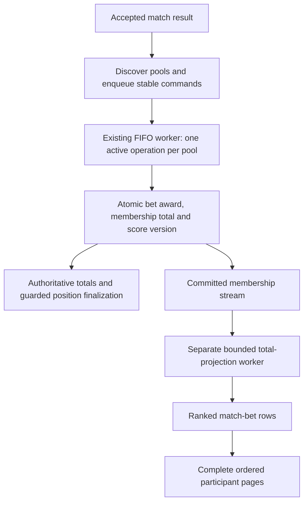

# Design

## Context

See [proposal.md](proposal.md) for motivation and [reference/README.md](reference/README.md) for the three supplied designs and their repaired copies.

Both platforms already have `MatchBetListView`, `MatchHeader`, and `MatchGamblerBetItem`. Their header sits outside the list; rows lack the shared avatars and the recent History/Timeline semantics. The current iOS list uses a tap gesture, and the router silently ignores taps on the signed-in gambler. That row should instead have no activation semantics.

`PoolGamblerBetModel.score` is a single-match award. The authoritative pool total is the score on a pool membership record. `GetPoolMatchGamblerBetsRequestBuilder` currently queries `GetPoolGamblerScoresByMatch-index`, whose sort key is `POOL#…#GAMBLER#…`, not a points ranking. That index also serves score fan-out and must retain its current keys and purpose. `GetPoolScoresRequestBuilder` already queries the pool-total index descending. See `docs/database-model.md` for the underlying records and indexes.

Scoring currently commits the selected match award and membership total together. It does not update that member's other match rows. The repository orchestrates all pools for a match, publishes position messages after scoring, swallows broad transaction cancellations, and writes membership/detail positions independently from an eventually consistent score index. The layout handler groups result computation before match materialization. Stream mappings and the positions FIFO lack explicit bounded retry/failure-retention configuration. These paths need hardening as part of the source-version integration.

New-member totals start at zero; removed members can retain computed bet records. Existing Pool stream/SQS patterns support the selected flow, but do not yet maintain total-point projections. The repository's SAM template references an externally managed Pool table/stream; no table/index resource definition was found locally. Read `docs/database-model.md` before changing persistence.

The selected workload is thousands of participants per pool with many concurrent match viewers. The accepted persistence change moves the join from each page request into background writes. It does not assume that one indexed query alone removes all throughput limits.

The existing lock occurs ten minutes before scheduled kickoff. `isLive` means `isLocked && !isComputed`; it is not an authoritative lifecycle status. The recently completed `redesign-gambler-timeline` change already avoids interpreting this flag as proof of live play, and its shared paging-recovery fixes must be retained.

## Goals / Non-Goals

**Goals:**

- Preserve one match destination and one maintained header/participant-row layout per platform, with explicit presentation states.
- Make the entire participant feed follow current pool totals descending while retaining the distinct meaning of match awards.
- Read complete ranked participant payloads from one dedicated index path, without leaderboard-to-bet enrichment or tie-group rereads.
- Make asynchronous total/lifecycle projections recoverable, observable, and safe to migrate alongside scoring.
- Serialize settlement and position finalization per pool through the existing FIFO consumer, with atomic idempotent writes and bounded resumable work.
- Keep scoring rules in the domain, orchestration in application/event handlers, and repositories limited to data access.
- Keep state, private own-prediction data, and paging scoped to authenticated account, pool, and match.
- Reuse the established avatar, colors, formatting, press feedback, placeholder, and accessibility behavior without changing unrelated screens.

**Non-Goals:**

- Changing the lock interval, scoring formulas, existing late-join/retention rules, original index keys, leaderboard UI, or adding prediction editing to this destination. Scoring orchestration and persisted-position reliability are in scope.- Adding a true live clock/status feed, automatic polling, or a historically frozen leaderboard at the time a match finished.
- Adding Redis/ElastiCache, response caching, or an atomic published-ranking snapshot. The selected approach uses persisted per-detail projections with explicit eventual convergence.
- Adding a separate scoring-job table/service, a generic workflow framework, or a new result-correction UI/API. Small operation receipts live in the existing Pool table; the existing supported correction procedure must follow the new write contract.
- Reproducing screenshot device frames, missing-glyph squares, or example names/scores as app assets.

## Decisions

### 1. Separate visibility, computation, and match lifecycle

Use the existing server lock/computation values for a small presentation state:

| State | Header | Body |
| --- | --- | --- |
| Predictions open, not computed | Neutral localized Starts date/time pill; teams around VS | Hidden-bets explanation and the signed-in gambler's own prediction |
| Locked, not computed | Neutral Bets closed pill; teams around VS when the match score is absent | Ranked participant predictions, explicit No bet, no numeric awards |
| Computed | Localized date/time; teams around a prominent final result | Ranked participant predictions and authoritative match-award pills |

If an uncomputed record contains a match score, show it as an available match score without calling it final. A missing computed result uses neutral dashes, never an invented 0–0. Computed presentation takes precedence over the lock flag.

The In progress label/red pill in the supplied revealed-state image is a hierarchy reference. Ship Bets closed with the current contract. A later authoritative lifecycle feature can supply actual live status without redefining prediction visibility.

**Rationale:** A single boolean cannot establish that play has started or ended. Time since scheduled kickoff also cannot prove this.
**Alternative:** Copying the reference's label literally misrepresents the pre-kickoff lock window and delayed settlement.

### 2. Follow the latest hidden-state reference and preserve its privacy behavior

Use the centered start pill, large team identities around VS, open space without a divider under the matchup, neutral lock illustration, Bets are hidden heading, supporting explanation, and Your bet line from the latest reference. Center the explanatory group in the remaining visible space when it fits; let the whole content grow and scroll at larger text sizes.

Keep existing match-detail entry actions enabled for loaded upcoming matches, including while predictions remain open. Activation opens this destination and its hidden state; the visibility gate controls other participants' predictions without blocking navigation. The screen provides useful match context, reveal timing, and the viewer's own prediction before betting closes. Preserve existing prediction-editing controls and keep placeholders inert. Use the same navigation behavior for touch, supported keyboard activation, VoiceOver, and TalkBack.

The revised copy is:

| English | Spanish |
| --- | --- |
| Bets are hidden | Las apuestas están ocultas |
| Everyone's bets are revealed when betting closes for this match. | Las apuestas de todos se mostrarán cuando se cierren las apuestas de este partido. |
| Your bet | Tu apuesta |
| No bet | Sin apuesta |
| Bets closed | Apuestas cerradas |

The latest reference supersedes the earlier suggestion to preserve the old warning wording. The reveal timing remains unchanged; the reference's phrase when the match starts is not the timing contract.

Pass the authenticated account ID explicitly into the match screen's presentation context. The route's gambler ID can belong to another participant when arriving from Timeline; it must not become the owner of Your bet. Reuse a known own-prediction model when available or request the existing single-bet endpoint for the authenticated account, current pool, and match. Keep that request independent of the match heading. Distinguish loading, confirmed no bet, and failure; offer a local retry on failure. Own prediction is informational, with no new edit control.

**Rationale:** The latest design exposes information the viewer is already entitled to see without revealing another participant's open prediction.
**Alternative:** Labeling the route's selected gambler model as Your bet silently attributes another person's prediction to the viewer.

### 3. Store current pool totals on match details and query a dedicated index

Keep membership `score` as the authoritative total and match-bet `score` as the award for that match. Add separate projection metadata to the existing bet item; do not overwrite either meaning or create a second prediction record.

| Record | Additional data | Purpose |
| --- | --- | --- |
| Membership | `membershipGeneration`, monotonic `scoreVersion` | Identify one membership lifetime and version its authoritative total |
| Match bet | `totalPoolPoints`, known/unavailable state, `poolScoreVersion`, `poolMembershipGeneration`, `rankingActive` | Copy the current total and fence score/lifecycle updates |
| Match bet | Dedicated ranking partition and sort keys | Read complete rows in pool-total order without another bet lookup |

Create a new GSI, provisionally `GetPoolMatchBetsByTotal-index`, with partition key `POOL#<poolId>#MATCH#<matchId>`. Its ascending sort key encodes the tuple **known before unavailable, numeric total descending, gambler ID ascending**. Use a versioned, fixed-width, order-preserving encoding for the full supported score domain; raw unpadded decimal strings are not suitable. Store the numeric `totalPoolPoints` separately. Explicit unavailable keys occupy the trailing range and include the gambler ID; they must not disappear from this index merely because the numeric total is absent. Confirmed zero belongs to the known range. Malformed data and failed source reads are repair/error cases, not unavailable totals or zero.

This new key preserves the existing stable tie rule directly in index order, including an all-zero pool. It needs neither complete tie-group reads nor a separate missing-total scan. Inactive projections have their new ranking key attributes removed; retained tombstone metadata prevents old work from reactivating them. The existing score-by-pool and score-by-match indexes remain intact.

Project only the fields needed for participant identity, existing avatar reference construction, prediction/No bet, match award, and projection metadata. Return these payloads directly from the GSI; neither a second bet read nor a per-page membership/total enrichment belongs in the normal participant-feed path. A page fits one query when it is within the service/page limits; ordinary native continuation can require more requests. Requester authorization, trusted match heading/visibility, and rollout-readiness reads are separate, so this is not a claim that the entire endpoint always uses exactly one database operation. The new numeric total stays an internal sorting input; mobile still displays this-match award pills.

**Rationale:** The accepted trade-off pays for copies when totals change to reduce repeated read work for concurrent viewers. A dedicated key also makes deterministic ties inexpensive.
**Alternatives:** Ranking membership pages and batch-fetching their bets avoids propagation writes but retains a second participant-data read stage on every page. Shared caching can reduce repeated reads but introduces cache infrastructure and invalidation; it is not part of this approach. Neither alternative is a silent fallback for ranked requests.

### 4. Settle bets and finalize positions as one ordered pool operation

The pool operation finishes settlement and positions independently of historical total propagation. Different pools can process concurrently. Within a pool, bounded parallel bet transactions are allowed, but the next logical operation cannot overtake the active one.

#### Dispatch and authoritative work discovery

The result handler publishes a versioned command to the existing positions FIFO before performing any settlement. A result command carries a stable logical operation ID, pool, match, result identity/version, operation kind, and the immutable result information needed to resume. A current-standings-only reconciliation command has no required match/result target. Delivery attempts reuse their logical identity; SQS deduplication is an optimization, not the idempotency contract. Preserve per-match source-record order and make materialization use current match state instead of processing all score records ahead of all inserts.

Use the existing match index for paged affected-pool discovery, including already-computed rows. Do not filter those rows out: a retry after some pools committed must still rediscover and notify them. Traverse every continuation, including empty filtered pages, and acknowledge the source event only after its discovered commands are durably accepted. Reconciliation and materialization events recover pools/details absent from an eventual discovery read; an empty GSI never establishes global completion.

Inside a discovered pool, query the base membership partition (`pk = POOL#<poolId>`, `begins_with(sk, GAMBLER#)`) strongly consistently and fetch the corresponding existing match details using bounded strongly consistent BatchGet requests, retrying unprocessed keys. This work happens once per settlement/recovery, not per viewer. A paged uncomputed-index query may be an optimization, but cannot establish the complete settlement scope. Preserve existing membership eligibility and late-join rules; a missing required detail is pending materialization/repair, not a fabricated No bet or successful settlement. A membership-revision check around enumeration detects joins/removals and restarts the affected pass.

#### Small durable receipts and resumable delivery

Keep a fixed-size active-operation checkpoint on the existing pool root: operation identity, assigned pool operation revision, immutable result/command information, stage, cursor, calculation revision, captured membership revision, and conditional ownership/fencing metadata. Add small receipt items in the existing Pool table at `pk = POOL#<poolId>`, `sk = SETTLEMENT#<stableOperationId>` to retain the operation's immutable payload identity, assigned revision, and admitted/completed state. Membership queries must remain restricted to `GAMBLER#`; receipt items carry no leaderboard score/index keys.

Admission conditionally creates the receipt and advances the pool operation counter/active state in one transaction. A retry reuses its receipt and revision; conflicting payload reuse is an error. A completed receipt makes an old A command a no-op after B, even if new members have joined. Atomically complete the receipt and clear the active operation only after both stages have completed. Retain receipts for the pool lifetime and delete them with the pool; do not expire them merely because SQS's deduplication window elapsed. These bounded individual records avoid an unbounded processed-operation map on the pool root.

For settlement, keep the original FIFO message unacknowledged across interrupted or time-bounded attempts. Checkpoint before the invocation deadline; the next delivery resumes the same operation. Do not append a settlement continuation behind later messages and acknowledge the original, because that allows overtaking or deadlock. Conditional ownership fencing prevents expired/overlapping workers from writing; lease expiry permits resuming the same operation, not replacing it with a later one.

If an active command reaches the DLQ, its durable active fence remains. A later delivered command can help resume that operation before starting its own, and remains unacknowledged until its own work is complete. A permanently blocked operation must surface as a blocked pool with bounded recovery and operator action, rather than silently advancing or repeatedly cascading later commands into dead letters. Historical projection continuations are separate and may use ordinary enqueue-before-ack continuation because their generation/version guards tolerate delivery reordering.

#### Atomic settlement and correction writers

Keep the pure evaluator and existing scoring formula. A single-bet repository transaction updates the detail's award/result/computation receipt and the matching membership's total plus score version atomically. Fence both records by membership generation and existence, and require the active operation's ownership/version. Preserve the existing computed guard for first settlement; duplicate writes do not add the award again. Record successful zero awards as computed while avoiding an unnecessary source-version bump or historical projection when the total is unchanged.

Classify cancellation reasons per transaction item and verify the terminal state. Already-applied work may be a successful no-op; a removed generation may be deliberately excluded after verification; missing required data remains repair work. A conditional failure is not automatically evidence of successful scoring. Conflicts, throttling, transport errors, and invalid data must propagate to the appropriate bounded retry or repair path.

All supported total repairs/result corrections enter the same ordered pool flow with a stable correction identity and expected result version. Their guarded transaction applies the difference from the prior persisted award, updates the detail and total together, and advances the total version only when it changes. Validate the expected prior settlement before accepting/enqueueing a correction and again before admission; reject unmet prerequisites recoverably without claiming the active fence. An invalid received correction is quarantined for repair rather than waiting at the queue head for its predecessor behind it. Update the manual correction procedure to use this contract and the current domain evaluator, replacing separate unguarded detail/master writes and stale hardcoded scoring constants. This requires an operator procedure/command, not a new public correction UI/API. Pure rank repairs use a new reconciliation identity without scoring settled bets again.

#### Authoritative, replay-safe positions

After settlement, strongly query the same base membership partition for totals, generation, score version, and position metadata; sort once per calculation pass by numeric total descending and gambler ID ascending. Do not calculate durable positions from the leaderboard GSI, or use absence of uncomputed rows in another GSI as a freshness barrier. These background reads do not change the direct-index participant endpoint.

Strongly consistent pages are not a transactionally frozen pool. Add a monotonic membership revision to the pool root, advanced atomically by join/remove/rejoin eligibility mutations. Supported total changes are serialized through the active pool operation. Capture and validate the membership revision around enumeration/calculation, and fence position writes/completion by the active operation, calculation revision, and unchanged membership revision. Each row also checks the observed membership generation and score version. An invalidation restarts calculation under a new calculation revision; it cannot be labeled completed. Membership changes after completion durably request a new position-reconciliation operation through the membership stream, including when no later match result arrives.

For result settlement/correction, write each membership/target-match position pair and its applied operation/calculation marker in one transaction. Capture that operation's original beforePosition once and retain it when a retry or recalculation replaces its position. Conditions require both existing records in the correct membership generation and reject older operation revisions. Missing required details go to repair; no position update can upsert a removed membership. A master marker alone is insufficient, and a single last-match field cannot distinguish A, B, and replayed A. Per-detail markers recover partial passes, while the pool receipt protects completed-operation replay globally. A repair after genuine late materialization has a new identity/revision and does not reuse a completed command as its only wake-up.

Distinguish current-standings reconciliation after membership changes: it updates only guarded membership positions/markers with the same input validation and replay protection. It works before any result exists and must not select the last completed match merely to satisfy a paired-write shape. Unrelated historical detail positions remain unchanged. A historical-detail repair is a separately targeted operation using retained operation evidence or verified repair inputs; it does not rewind the current membership or invent a past position from today's totals.

The operation is complete only after all required rows have a verified applied or deliberately excluded outcome and the captured source/operation conditions still hold. Persisted positions may be temporarily mixed during a pass; this design does not publish an atomic ranking snapshot. The new match-bets screen orders by copied totals, not these persisted positions.

#### Materialization and recovery

Both initial join and added-match materialization inspect the current authoritative result and apply existing eligibility/late-join rules. A row created after a result must be materialized consistently and request settlement/reconciliation when eligible work remains. The result/materialization race is covered in both directions by durable source events plus reconciliation of pending/missing rows; a read before insert or a local handler reorder alone is insufficient. Keep materialization in its existing owner: settlement and projection workers must not invent missing prediction records.

Before activating this flow, configure bounded stream retry/record age, failed-batch bisection, a full-event failure destination, and FIFO redrive/retention. Use an S3 stream failure destination with permissions so original records survive stream expiry; an SQS/SNS stream failure record containing only metadata is not enough for later replay. Keep source and destination retention, alarms, replay permissions, and operator instructions together. Apply the stream protections to the layout, membership, and result-ingestion mappings involved in this flow.

Size Lambda timeout, FIFO visibility, receive-count limits, and retention from measured settlement/position chunks, including checkpointed progress retries. A deliberate yield consumes receive count and visibility time; distinguish it from failed/no-progress attempts in metrics. Track active-operation age, last-progress age, redrive proximity, blocked pools, retained events, and DLQ depth. DLQ transfer retains recoverable work; it does not imply completion or safely release ordering.

**Rationale:** A durable command retains the pool identity after its last bet commits, so retries can finish positions. Existing-table receipts/checkpoints preserve ordering and recovery without adding another table or workflow service. Authoritative reads remove index propagation from settlement correctness; the costs are background reads/sorting and measurable retry latency.
**Alternatives:** Post-settlement notification can be lost after the final score commit. An early position notification plus an empty-GSI check can acknowledge stale or incomplete work. A separate generic scoring-job system adds infrastructure not needed for this scope. A master-only position marker leaves partial writes and old-message replay unsafe.

### 5. Propagate absolute versioned totals through durable background work

Advance `scoreVersion` atomically with each actual authoritative total/state change in the existing scoring transaction; preserve the match-scoring idempotency guard. Initialize a unique membership generation and initial version for newly created memberships. Existing memberships receive these through conditional, resumable initialization. A zero match award that leaves the total unchanged does not require copying an unchanged total to every match. All supported writers of membership totals, including repairs/corrections, must participate in this version contract.

Consume committed membership changes from the Pool stream and durably enqueue projection work using the existing stream/SQS architectural pattern. Verify and configure the stream's required old/new images, event filters, permissions, partial-failure behavior, and retry/dead-letter handling; a post-transaction best-effort send is not sufficient. Keep messaging/orchestration in application/event handlers and repositories limited to data access. Detail projection writes must not enqueue membership work recursively.

Each projection worker resumes from durable progress, reads the latest authoritative state, and traverses the member's base bet partition with bounded pages and bounded concurrent writes. Copy **absolute total/state plus version**, never replay score increments. Update the copied numeric value and ranking keys atomically on each existing detail, conditional on the same membership generation, active projection, and an older applied version. Projection workers cannot create missing bets, change generations, reactivate tombstones, or modify predictions/results/match awards. A newer legitimate decrease still replaces an older higher score.

Persist or durably enqueue continuation before acknowledging work. Repeated or out-of-order jobs converge through the conditional version guard; coalesce superseded versions by reading the latest source, without dropping work for unfinished matches. Distinguish stale/duplicate conditional no-ops from conflicts, throttling, validation failures, and transport failures. Do not reuse blanket transaction-cancellation swallowing for this path. Bound retries with backoff, retain failed work for repair, and expose age of pending work, failed chunks, and applied-version lag. Do not extend an existing short-lived scoring/position loop to process the entire historical projection synchronously.

**Rationale:** The current transaction cannot atomically update an unbounded match history. Durable propagation with versions tolerates partial progress and repeated delivery without changing scoring correctness.

### 6. Fence initialization and membership lifecycle changes

Only initialization, backfill, or deliberate rejoin rebinding may establish projection generation/eligibility. Read the authoritative membership and atomically condition the target initialization on its **active status, generation, and score version** still matching the seed. If any changed, retry from fresh state. A preceding read alone is insufficient: a score update could finish while the new detail is absent, followed by insertion with a stale total and no remaining job to repair it. Existing detail initialization also uses target conditions so it cannot overwrite a newer projection or replace production prediction/result fields.

Apply this protocol to initial pool/join materialization, newly added matches, repair of missing projection fields, and retained rows eligible under existing rejoin behavior. New match rows need a current total even when no new score event will occur. Missing bet records are created only by the existing materialization contract, never by a score worker pretending that absence means No bet.

Capture the removed generation from the stream old image. Removal work enumerates the member's base bet partition using strongly consistent reads, deactivates/removes ranking keys only for that generation, and preserves generation/version fences on retained computed records. Preserve the existing deletion/retention rules for actual bets. An old removal job cannot touch a row rebound to a newer membership. Transactionally guarded initialization prevents rows for a deleted generation from being created after its cleanup enumeration. Jobs that observe a missing or different current membership cannot activate that generation.

Apply the generation fence to physical deletion of uncomputed bets as well as index-key cleanup: the existing uncomputed-only delete condition cannot be left as an independent unscoped removal path, because a delayed old removal could delete a rejoined member's new bet. During rollout, events lacking generation metadata must use guarded legacy reconciliation or remain pending for repair, never an unconditional cleanup of the current membership's rows.

Other participants' membership projections, like their copied totals, may briefly lag source changes; after cleanup and index propagation, removed projections no longer appear. Do not add per-row membership validation to the read path to claim immediate projection consistency. This allowance never authorizes a removed requester: verify the requesting account's access and match reveal state from trusted sources on every request independently of the ranking projection.

**Rationale:** Historical bets survive some membership removals. Merely adding a new index to them would leave former-member rows visible indefinitely and would let delayed work corrupt a later membership.

### 7. Keep direct ranked paging compatible and explicitly eventual

Add explicit `sort=pool-score-desc` to the match-bets endpoint. Requests omitting it retain legacy behavior and cursor interpretation. New mobile consumers request it only through the supported rollout. Use a versioned opaque cursor containing the native GSI continuation key and binding it to pool, match, sort mode, and projection/key schema version. Resume from the last emitted item without skipping rows if an application page boundary differs from the storage page boundary. No unbounded ID list, score-group offset, or separate unavailable-total phase belongs in the cursor.

For unchanged projections and index state, pagination/retry produces complete global ordering with stable ties and no duplicate/missing rows. Empty pages with a valid continuation remain continuable; bound refill attempts instead of looping indefinitely. An unavailable index or known unready/failed migration scope produces a recoverable error, not legacy order, assumed zero totals, or a request-time batch join.

During propagation, a match can contain copies from different membership score versions. Index propagation adds its own eventual delay. The feed orders the available copies; it does not claim they all represent the same instant. Changes while paging may move rows across cursor boundaries. Mobile retains usable rows, deduplicates by gambler ID, and refreshes by replacing the entire feed from a new first page. Refresh does not wait for background jobs and can still see pending copies; after convergence it reflects authoritative current standings. There is no frozen snapshot or instant synchronization guarantee.

Enforce the existing requester authorization and server reveal boundary before returning any participant data. Verify trusted match lock/computation state independently of copied detail fields, including before-lock, unknown state, reschedule, and direct endpoint access. Projection or cursor metadata is not evidence of access. Preserve the client gate behavior during re-entry and refresh.

**Rationale:** Native index order supports efficient page reads while the explicit consistency contract prevents overstating freshness. Legacy mode permits a staged backend-first rollout.

### 8. Share presentation foundations while keeping one participant row

Redesign the existing Match header and participant components rather than creating a second match-bets screen. Reuse History's date formatting, semantic point colors, signed positive/neutral zero/unavailable treatment, and adaptive team/result hierarchy. Share a focused header or points primitive where needed, preserving History/Timeline defaults; do not force the participant list into a match-history row.

Use shared `AccountAvatar` for photos and initials, including its cache and fallback behavior. Identify the current user with a localized You marker and the established current-user treatment, without moving them out of rank order. Keep positive/neutral match-award pills distinguishable within a highlighted current-user row. Names wrap and prediction/points regions move below identity when necessary; keep each score pair together.

The match header belongs inside the scrolling content. Visible participant rows have thin full-column separators and stable avatar/name/prediction/award regions. Computed pills use localized +4 pts, 0 pts, or an unavailable mark; uncomputed rows omit numeric awards. An available zero-point award differs from an absent award, even when no prediction exists.

Other participants use a full-row native activation target with Android indication or iOS `InteractiveRowButtonStyle`. Own rows and placeholders have no button role, press response, or action. Preserve Back, Home, and other-gambler Timeline destinations.

**Rationale:** Existing production components carry the desired visual and behavioral conventions. Shared low-level primitives avoid duplicated formatting without combining unrelated row responsibilities.

### 9. Preserve known content and explicit recovery

Separate match/gate state, private own-prediction state, and ranked paging. Initial gate loading can show the production header's placeholder but cannot briefly render already cached participant values. Once access is confirmed, load the ranked feed. The hidden state retains an ordinary refresh path to recheck the gate; no polling or client clock alone reveals bets.

A refresh rechecks match/gate, refreshes own prediction when applicable, and starts a new ranked generation. Retain confirmed accessible content with refresh feedback while permitted by the last confirmed gate. If the gate is confirmed open again, immediately remove other-participant content and its accessibility nodes. Header/list/own-bet failures expose appropriately scoped retry and do not relabel a request failure as No bet or zero. The last confirmed header remains visible on a recoverable refresh failure with explicit update-failure feedback.

Discard obsolete responses after a newer refresh or account/pool/match change. Preserve append retry, viewport-centered full-list errors/empty states below the header, and the existing fixes that prevent paging-recovery request loops.

**Alternative:** A single all-or-nothing load hides usable content; unconditional paging can expose rows before the header establishes the privacy state.

### 10. Apply shared accessibility, placeholders, and icon policy

Give the header one meaningful match announcement and each participant one meaningful announcement with full name, You when applicable, team-qualified prediction or absence, and this-match award when computed. Preserve native activation semantics. Announce hidden status and the private own prediction separately; hide decorative flags, avatars, separators, and lock artwork from independent traversal.

Use the existing platform type styles and full supported text scaling. Use reflow, wrapping, and scrolling instead of shrinking accessible text or fixed row heights. Preserve light/dark canvases, 4.5:1 ordinary text contrast, native minimum hit targets, iOS navigation materials, Android edge-to-edge, English/Spanish resources, plural point names, and device date/time preferences.

Every model-backed initial/append/own-prediction loading region uses its production component populated with a stable placeholder model and `isPlaceholder`. The shared loading treatment owns motion preferences; no skeleton-only layout or caller-provided pulse effect is introduced.

For affected app-rendered Back/Home/lock glyphs, reuse the intended existing geometry when possible and establish a committed canonical vector source shared by both platforms. Prefer Material Symbols for semantically suitable new/replaced glyphs; custom icons are allowed without justification. Fully OS-rendered controls and status bars are excluded. Raster reference repairs clarify missing glyphs and are not production icon assets.

## Risks / Trade-offs

- [Poison events block a shard or pool, or bounded retries discard work] → Deploy full-event retention, stream isolation, FIFO redrive, alarms, and replay instructions together. Retain the pool's active fence across DLQ transfer and surface blocked work for bounded repair.
- [A continuation lets a later result overtake unfinished scoring] → Keep the original settlement message until both stages finish; persist checkpoint/ownership fences, distinguish progress yields from failures, and size receive/visibility/retention budgets from measured work. Projection continuations remain independent.
- [Duplicate, partial, or older settlement corrupts totals or movement] → Atomic generation/version-guarded score and position transactions, stable per-operation baselines, durable operation receipts, and fault tests including A/B/A replay, new joins, and expired ownership.
- [Position reads span membership changes] → Strong base queries plus membership-revision invalidation, guarded writes/completion, and durable membership-triggered reconciliation. Strong pages alone are not a frozen snapshot.
- [Old and new scoring consumers write concurrently during rollout] → Explicit producer/consumer cutover, retained events, legacy-message handling, and post-cutover reconciliation; source-version-aware writers must remain active during UI rollback.
- [Ranked output is incorrectly sorted by match awards] → Distinct domain meanings and a fixture where the pool leader earned zero on this match while a lower-ranked member earned four.
- [Score changes amplify writes] → For C changed members with M match rows each, plan for roughly C × M detail updates plus index maintenance. Use bounded durable work, skip unchanged totals, coalesce superseded versions, and measure backlog and write capacity under scoring bursts.
- [Large pools concentrate reads on one match partition] → Load-test thousands of participants and many concurrent viewers against realistic item sizes and index capacity. One query is not a throughput guarantee; record throttling, p95 latency, consumed capacity, and the supported load envelope before enabling the mode.
- [Delayed work overwrites newer totals or a rejoined member] → Atomic source versions, generation fences, conditional target updates, and transactional initialization guards; exercise reversed event order and partial failures.
- [Copies/indexes lag or move during paging] → Explicit eventual standings and participant eligibility, independent requester access checks, deduplication, refresh after convergence, and measured lag alarms. Do not claim immediate or snapshot consistency.
- [Unavailable or unmigrated rows disappear from a sparse index] → Explicit unavailable sort-key range, mandatory initialization/backfill coverage checks, rollout readiness, and ongoing reconciliation. Never infer complete migration from a successful empty query alone.
- [Migration/worker failures are silently ignored] → Classify conditional failures, preserve durable progress, alert on dead letters and lag, and rehearse repair and rollback.
- [Own-bet ownership follows the route rather than authentication] → Separate authenticated ID and selected gambler ID, with account/pool/match isolation tests.
- [Reference copy suggests kickoff rather than the existing lock] → Normative copy and state mapping above take precedence over screenshot labels.
- [Large text or warning centering hides content] → One scrolling composition, flexible heights, narrow/landscape/tablet checks, and first/last-element reachability.
- [Shared primitives regress History/Timeline or recovery loops return] → Preserve defaults and include focused neighboring-screen and bounded-request verification.

## Migration Plan

1. Establish deployment ownership for the existing Pool table/stream and record deployed keys, projections, stream images, and capacity. Ship explicit retry/age limits, stream batch isolation/full-payload failure retention, FIFO redrive, alarms, and replay instructions as the first runtime prerequisite. Keep ranked mode gated off.
2. Before changing settlement logic, add failure-path tests using a stateful fake DynamoDB client and queue boundary capable of atomic conditions, partial failures, duplicate/reversed delivery, and delayed index views. Reproduce lost notification, broad cancellation swallowing, independent position writes, materialization races, timeout resumes, and old-message replay. Follow applicable AGENTS.md exploration prerequisites before authoring tests. Use real integration checks later for behavior a fake cannot establish.
3. Add conditional metadata initialization, settlement receipts/checkpoints, version-aware writers, authoritative queries, and the versioned FIFO consumer behind a rollout gate. Define the initial result version and legacy computed-receipt mapping without recomputing existing awards. Add the dedicated GSI and required membership/projection resources without replacing existing tables or indexes.
4. Rehearse and execute an explicit scoring cutover: quiesce legacy dispatch/computation while retaining incoming events, and drain or safely translate legacy position messages. Before activating the new scorer, deploy generation-aware join/added-match/removal writers and conditionally initialize both memberships and eligible existing bet identities under current source guards. Verify identity coverage; ambiguous retained/rejoined data remains gated for repair rather than being rebound by guesswork or bypassing conditions. Then switch to the new command consumer and enqueue-before-settlement producer, reconcile earlier committed work, and resume delivery. Never run unguarded legacy scoring beside the new pool worker. Update the manual correction procedure before reopening corrections.
5. Enable durable membership projection handling before the separate total/ranking backfill. Backfill all eligible historical match rows through the guarded, rate-limited, resumable initializer; identity readiness from the scoring cutover remains a prerequisite. Preserve predictions/results/awards; malformed/missing records go to repair. Exercise overlap with scoring, removal/rejoin, and new match materialization.
6. Verify coverage, field parity, active/inactive generations, known/unavailable order, and cursor traversal after workers and GSI updates converge. Track readiness per pool and keep unresolved scopes disabled. Retain reconciliation for missing/late materialization, positions, projections, and lost/expired work; successful empty index reads do not establish completeness.
7. Exercise the direct ranked endpoint and compare against authoritative data after convergence. Use a representative 5,000-member pool with 100 match rows each, a 1,000-viewer burst, all-zero ties, consecutive results in the same/different pools, correction waves, progress retries, and failure replay. Record page p50/p95, participant-read counts, settlement/finalization duration, strong-read/sort cost, read/write capacity, throttling, retry/visibility delay, projection lag, and backlog recovery. Set and meet explicit service budgets before broad enablement; these workloads are verification targets, not measured guarantees or product limits.
8. Enable ranked backend mode only for verified scopes before mobile consumers request it. Ship platform data/context wiring and the three-state redesign. Before authoring executable mobile tests, use the required ARTEMIS exploration/device-selection process and verify corresponding iOS flows. Record backend checks and platform captures in `verification.md` during implementation.
9. Roll back mobile ranked usage or the endpoint gate first; explicit ranked requests fail recoverably and legacy clients keep their contract. Preserve version-aware source writers, receipts, checkpoints, failure payloads, and queued work. A worker rollback must retain the new version/operation contract or pause and reconcile; do not restore unguarded legacy scoring alongside active operations. Revalidate stopped workers before re-enabling. Do not delete original indexes or rewrite authoritative totals during rollback.
