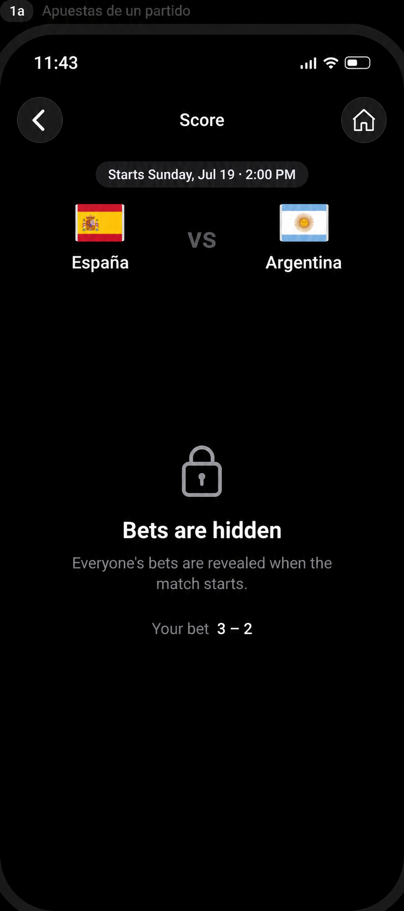
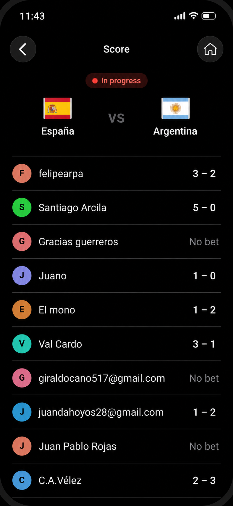
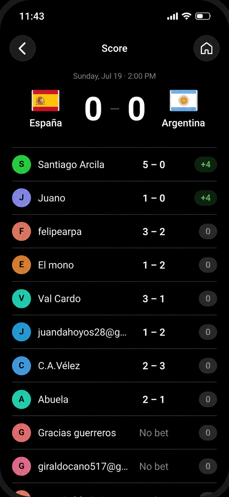

# Match-bets design references

The user supplied three raster references during exploration and requested copies with missing icons repaired. Originals are retained unchanged in `originals/`. The repaired files below were produced with the built-in imagegen editing tool on 2026-10-07 and visually inspected for recognizable Back, Home, status, and lock glyphs. Generated repairs can introduce minor raster, size, or spacing differences; these are visual references, not pixel-perfect source assets or production screenshots.

## Corrected references

### Hidden bets

- Source: [user original](originals/match-bets-hidden.png), attachment `codex-clipboard-1dc001fd-9c3c-4fd6-8098-fe1c48989042.png`.
- Use: centered Starts pill; flags and team names around VS; generous open spacing; neutral lock; hidden-bets heading/body; own-prediction line.
- Repairs: missing Back/Home glyphs, status icons, and the gray square above Bets are hidden replaced by a closed lock.

### Revealed bets awaiting computation

- Source: [user original](originals/match-bets-revealed.png), attachment `codex-clipboard-1f8b3e04-6005-47f8-9189-ed309ea98862.png`.
- Use: status above matchup; circular avatars; name/prediction rows; explicit No bet; thin separators; no earned-point pills before computation.
- Repairs: missing top navigation/status chrome restored with Back/Home glyphs and a Score title.

### Computed result

- Source: [user original](originals/match-bets-finished.png), attachment `codex-clipboard-23f0b20c-944b-4f95-8420-a4d11a852baa.png`.
- Use: date/time above a prominent final result; the same participant identity/prediction layout; positive/neutral award pills.
- Repairs: missing Back/Home glyphs and status icons.

## Behavioral precedence

The [match-bets specification](../specs/match-bets/spec.md) and [design](../design.md) govern behavior where images use illustrative copy or data:

1. **Ranking:** both revealed and computed lists use current authoritative **total points in the selected pool, descending**, with stable ties. The images' sample name order and this-match awards do not define ranking. A pool leader with zero points on this match still precedes a lower-ranked gambler with +4 on this match. No total-points column is being added merely to communicate the sort key.
2. **Visibility:** keep the existing server lock, ten minutes before scheduled kickoff. The hidden image's when the match starts wording is replaced by when betting closes for this match in the product. This changes explanatory copy, not reveal timing.
3. **Status:** the revealed image's In progress pill is illustrative. With the existing lock/computation data, use neutral Bets closed; no true live status is inferred.
4. **Ownership:** Your bet always belongs to the authenticated viewer, including when the route was reached from another participant's Timeline. No private prediction from that selected participant is substituted.
5. **Awards:** final-row pills show this match's authoritative award using existing localized units (+4 pts, 0 pts, or unavailable). Missing points and missing predictions are distinct; missing data never implies zero.
6. **Adaptation:** light/dark appearance, native chrome, large text, wrapping, reflow, safe areas, and accessible semantics take precedence over fixed image dimensions. Current-user identification follows the existing app conventions.
7. **Icons:** repaired raster glyphs communicate intent only. Affected app-rendered icons use shared canonical vector sources as required by AGENTS.md; status bars and entirely OS-rendered controls remain native. The outer 1a label and phone frames are presentation framing, not app UI.

## Edit provenance

The exact per-image prompts are saved in [image-edit-prompts.md](image-edit-prompts.md). The built-in imagegen tool was used; no CLI/API fallback or hand-painted raster editing was used. The original attachments remain available alongside each corrected reference so implementation can compare both.

| Corrected file | Generated source basename |
| --- | --- |
| `match-bets-finished.png` | `exec-3342465e-e5ef-49e5-8226-7d410cca5339.png` |
| `match-bets-revealed.png` | `exec-8a34aae9-9b6e-4110-a795-7ed79542f2b8.png` |
| `match-bets-hidden.png` | `exec-c52a5309-2dfe-4372-a329-350171d78a96.png` |
