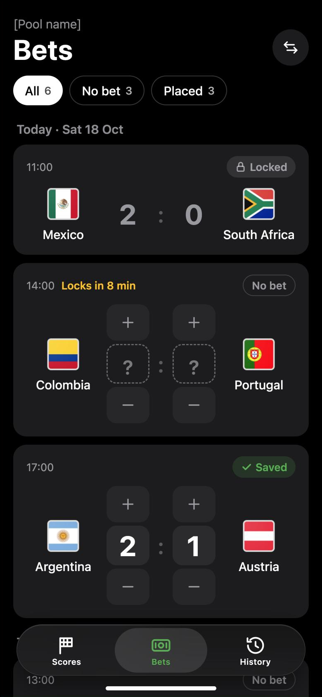
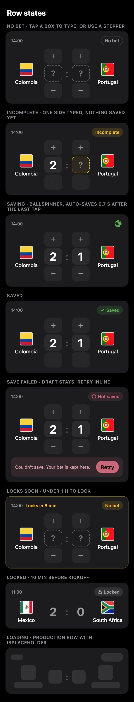

# Bet entry design references

Two boards exported on 2026-10-18, and re-exported on 2026-10-19, from the design canvas "Fortuna Bet Entry Redesign" (https://claude.ai/artifact/V4qCij3g1QF1DT6Bao9fWx, private to the owner). They are visual references, not production screenshots: the sample teams, dates, scores, and the pool name are illustrative.

## Bets list

- Use: "Bets" heading with the pool name above it; All / No bet / Placed filter chips with counts; date headers; one card per match with flags, team names, kickoff time, status pill, score boxes, and steppers. Every open card has the same height.
- The floating bottom bar is the iOS 26 Liquid Glass tab bar as the OS renders it. It is not app UI; Android keeps its primary tab row.
- Flags are the repo's `flag_xx.png` assets at 44 pt, larger than today's 32 pt, to balance the 34 pt score digits.

## Row states

Top to bottom: No bet (dashed `?` boxes), Incomplete (one side typed, amber pill and an amber dashed box on the missing side), Saving (shared ball spinner in place of the pill), Saved (green check pill), Not saved (error pill, inline banner with Retry), Locks soon (amber "Locks in 8 min" note and amber card outline), Locked (muted read-only scores, no controls), Loading (production card with the placeholder treatment).

## Behavioral precedence

The [bet-entry specification](../specs/bet-entry/spec.md) and [design](../design.md) govern behavior where the boards use illustrative data:

1. **Saving:** there is no Save button; a complete prediction saves after a short debounce. The boards' 0.7 s is the target, not a contract.
2. **Incomplete:** one typed side never saves and is never padded with 0. The amber dashed box on the missing side and the amber Incomplete pill show the state; there is no hint line.
3. **Quick picks:** removed on 2026-10-19. The cards have no quick-pick chips.
4. **Lock:** the lock stays ten minutes before kickoff, enforced by the server. The "Locks in N min" note appears during the last hour before the lock.
5. **Counts:** filter counts cover the matches loaded so far, not the whole pool.
6. **Adaptation:** light appearance on Android, large text, wrapping, safe areas, and accessible semantics take precedence over the boards' fixed 390 pt width.
7. **Icons:** glyphs on the boards are hand-drawn stand-ins; the app uses Material Symbols from the shared canonical vector sources and the existing ball spinner.
